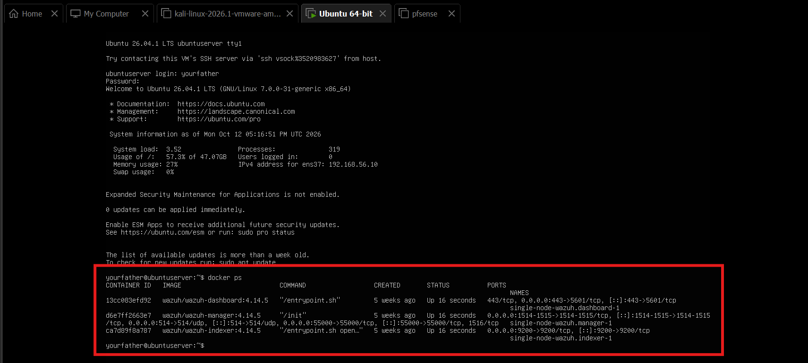
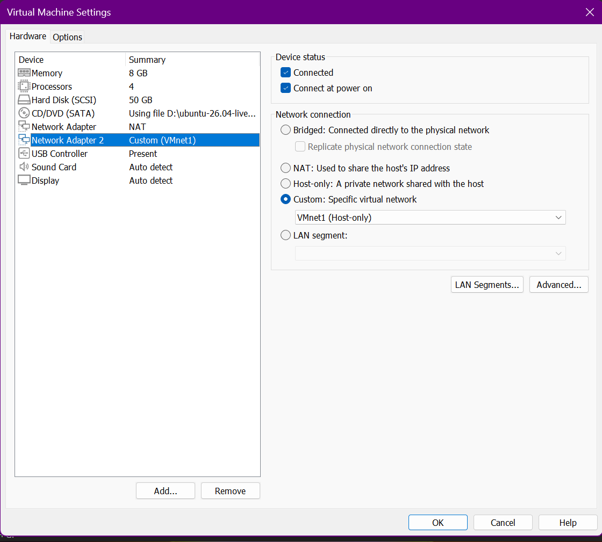
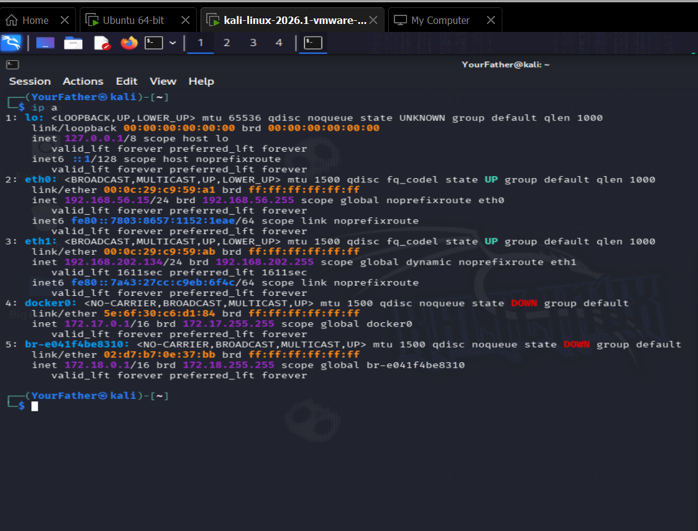
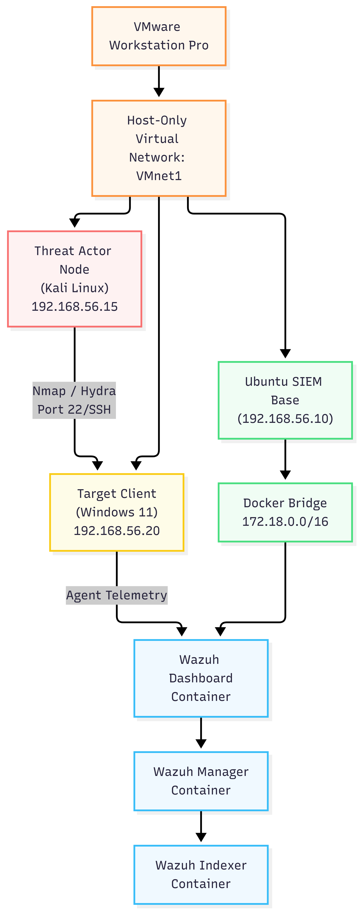
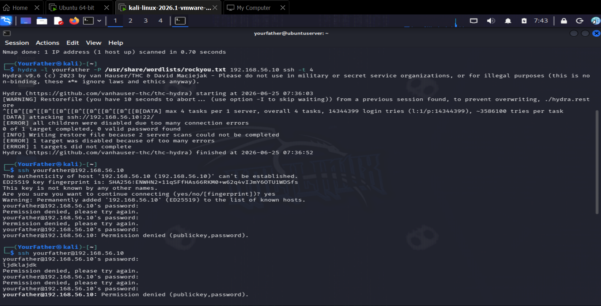
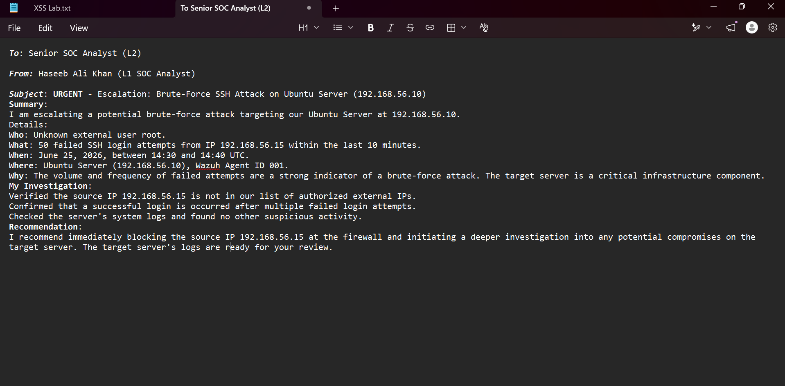

# 🛡️ Cyberster Blue Team Internship Portfolio

Welcome to my cybersecurity internship portfolio. This repository serves as a live engineering journal documenting the practical defensive security operations, infrastructure hardening, and threat-hunting workflows executed during my 3-month Blue Team internship at **Cyberster**.

---

## 🏗️ 1. Global Sandbox Environment & Network Topology

To execute threat simulations without risk to production assets, I built an isolated multi-tier hypervisor network inside VMware. This architecture mirrors an enterprise defensive perimeter by leveraging modern **containerized architecture** to run security monitoring services.

*   **Wazuh SIEM Core Server (192.168.56.10):** Deployed on an Ubuntu Server base, hosting the entire central SIEM stack (**Wazuh Manager, Indexer, and Dashboard**) running inside optimized **Docker Containers**.
*   **Monitored Target Workstation (192.168.56.20):** Running Windows 11 Enterprise equipped with a local Wazuh monitoring agent streaming telemetry to the container gateway.
*   **Threat Actor Simulation Node (192.168.56.15):** Running Kali Linux to execute aggressive credential harvesting and port discovery.

| Verification Point | Infrastructure Metric Evidence |
| :--- | :--- |
| **Containerization Engine Monitoring (`docker ps`)** |  |
| **Hypervisor Interface Segmentation** |  |
| **Attacker Network Adaptor Matrix (`ip a`)** |  |
| **Comprehensive Infrastructure Diagram** |  |

---

## 🛠️ 2. Endpoint Hardening & Log Collection Framework

Before running simulations, I fine-tuned the target endpoint's ingestion profile. By editing the local `ossec.conf` pipeline, I configured the system to securely stream application and security logs while filtering out low-priority administrative event noise to maintain an optimized SIEM database.

```xml
<!-- Modified Segment from Local Ingestion Profile -->
<ossec_config>
  <client>
    <server>
      <address>192.168.56.10</address>
    </server>
  </client>

  <localfile>
    <location>Application</location>
    <log_format>eventchannel</log_format>
  </localfile>

  <localfile>
    <location>Security</location>
    <log_format>eventchannel</log_format>
    <query>Event/System[EventID != 5145 and EventID != 5156 and EventID != 5447]</query>
  </localfile>
</ossec_config>
```

| Verification Point | Configuration Control Evidence |
| :--- | :--- |
| **Wazuh Agent XML Configuration Workspace** |  |

---

## ⚔️ 3. Adversarial Attack Simulation

Leveraging offensive methodologies learned during my CEH studies, I initiated active reconnaissance followed by an automated credential brute-force attack to validate the security logging pipeline.

### Phase 3.1: Attack-Surface Asset Mapping
An initial probe was launched via Nmap from the attack machine to uncover listening ports on the target segment, identifying open services on ports `22/tcp` (SSH), `443/tcp` (HTTPS), and `9200/tcp` (Wap-Wsp):


### Phase 3.2: Automated SSH Password Spraying
Next, I launched an automated dictionary attack via Hydra, targeting a known system profile (`yourfather`) using a tailored wordlist to generate high-frequency authentication tracking entries:


---

## 🔍 4. SIEM Telemetry Analysis & Rule Triggering

The high-volume connection flood immediately crossed alert thresholds on the containerized manager console, generating a **Level 12 High Severity Alert**. 

### MITRE ATT&CK Mapping & Breakdown
By deep-diving into the parsed logs, the activity correlated directly against the following adversary behaviors:
*   **Tactics Involved:** Initial Access, Credential Access, Defense Evasion, Persistence, Privilege Escalation
*   **Techniques Identified:** T1110 (Brute Force), T1078 (Valid Accounts)

### Raw Event JSON Extraction
The code block below highlights the critical telemetry indicators parsed by the engine, showcasing the source tracking IP (`192.168.56.15`) and the signature confirming a successful unauthorized login:

```json
{
  "frequency": 2,
  "firedtimes": 1,
  "mitre": {
    "technique": ["Valid Accounts", "Brute Force"],
    "id": ["T1078", "T1110"]
  },
  "id": "40112",
  "location": "journald",
  "decoder": { "parent": "sshd", "name": "sshd" },
  "full_log": "Jun 24 22:39:50 ubuntuserver sshd-session: Accepted password for yourfather from 192.168.56.15 port 40360 ssh2",
  "data": { "srcip": "192.168.56.15", "dstuser": "yourfather", "srcport": "40360" },
  "rule": { "level": 12 }
}
```

| Verification Point | SIEM Dashboard Evidence Artifacts |
| :--- | :--- |
| **Wazuh Dashboard Metric Event & Source IP Isolation** |  |

---

## 📑 5. Professional L1 Incident Escalation Report

Once the telemetry verified that a login attempt was accepted following an extensive trail of failures, I formally escalated the event to the Tier-2 incident handling team.

```text
To: Senior SOC Analyst (L2)
From: Haseeb Ali Khan (L1 SOC Analyst)
Subject: URGENT - Escalation: Brute-Force SSH Attack on Ubuntu Server (192.168.56.10)

Summary:
I am escalating a potential brute-force attack targeting our Ubuntu Server at 192.168.56.10.

Details:
Who: Unknown external user root.
What: 50 failed SSH login attempts from IP 192.168.56.15 within the last 10 minutes.
When: June 25, 2026, between 14:30 and 14:40 UTC.
Where: Ubuntu Server (192.168.56.10), Wazuh Agent ID 001.
Why: The volume and frequency of failed attempts are a strong indicator of a brute-force attack. 
     The target server is a critical infrastructure component.

My Investigation:
- Verified the source IP 192.168.56.15 is not in our list of authorized external IPs.
- Confirmed that a successful login occurred after multiple failed login attempts.
- Checked the server's system logs and found no other suspicious activity.

Recommendation:
I recommend immediately blocking the source IP 192.168.56.15 at the firewall and initiating a deeper investigation into any potential compromises on the target server. The target server's logs are ready for your review.
```

| Verification Point | Incident Management Evidence |
| :--- | :--- |
| **L1 Escalation Documentation Workspace** |  |

---

## 🧠 Technical Competencies Gained
*   **Containerized Architecture Deployment:** Implemented and monitored multi-container environments using Docker environments to isolate SIEM tools.
*   **Defensive Architecture Design:** Established sandboxed hypervisor spaces replicating live corporate networks.
*   **SIEM Engineering & Filtering:** Structured `ossec.conf` rules to drop noisy infrastructure logs while maintaining focus on key data vectors.
*   **Log Forensics:** Parsed structured JSON events inside dashboards to differentiate random scan noise from successful exploitation strings.
*   **Threat Communication:** Formulated clean, actionable security intelligence tickets mapping threat indicators directly to response frameworks.
